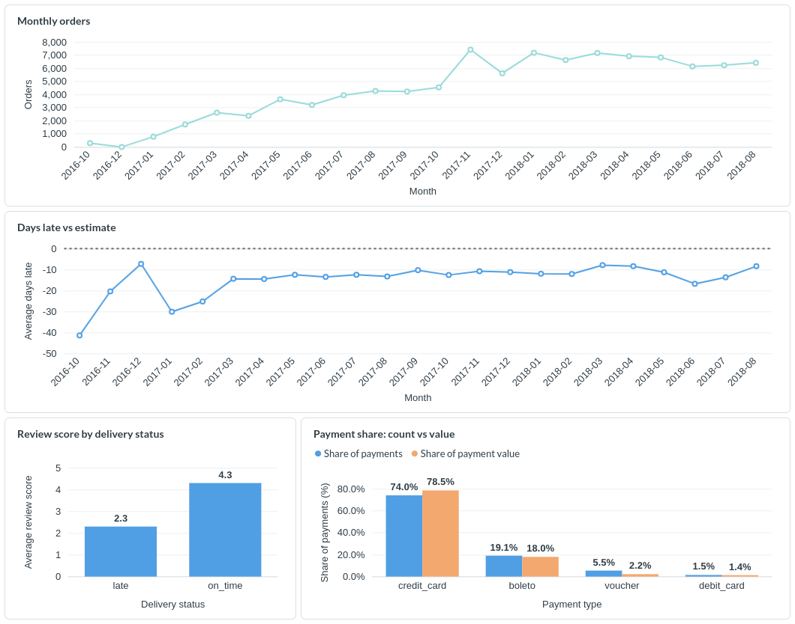

# E-commerce Data Analysis

Analysis of the [Olist Brazilian E-commerce dataset](https://www.kaggle.com/datasets/olistbr/brazilian-ecommerce) from Kaggle, which contains approximately 99,000 orders placed between 2016 and 2018.

## The Question

Do late deliveries hurt customer satisfaction, and how is the marketplace changing over time? As the company grows, it may face operational challenges. Using the public Olist Brazilian E-commerce dataset, I analyzed growth, delivery performance, reviews, and payments.



## What I Did

- Loaded and combined 9 tables from the Olist Brazilian E-commerce dataset
- Prepared the dataset: checked for missing values, fixed column names and data types, and handled bad values like zero weights
- Ran 5 SQL queries to analyze orders, deliveries, reviews, customers, and payments
- Built a dashboard to present the main findings and trends

## Key Findings

- **Monthly orders grew 22x in two years.** Monthly orders increased from 293 in October 2016 to 6,421 in August 2018. Monthly revenue also increased from approximately BRL 44,000 to BRL 849,000, while average order value decreased slightly
- **Most orders arrived earlier than estimated.** Orders were generally delivered before the estimated date, although the delivery gap became smaller and more consistent over time. Overall, about 6.8% of delivered orders arrived later than estimated. The monthly rate varies considerably, ranging from 1% to 17% during 2018
- **Late deliveries are linked to lower review scores.** On-time orders received an average score of 4.3/5, compared with 2.3/5 for late orders
- **Only 3% of orders came from returning customers.** Repeat orders represented approximately BRL 368,000 in revenue, or 2.7% of total revenue
- **Credit cards represented a larger share of payment value than payment volume.** Credit cards accounted for approximately 74% of payment records but 78% of total payment value. Boleto (Brazilian bank slip) represented around 19% of payment records and 18% of payment value, while vouchers represented 5.5% of records but only 2.2% of payment value

## How to Run

1. Clone the repository.
2. Download the dataset from [Kaggle](https://www.kaggle.com/datasets/olistbr/brazilian-ecommerce), create a `data/raw/` folder, and put the 9 CSV files there.
3. Create a virtual environment and install the dependencies:

```bash
python -m venv .venv
source .venv/bin/activate
pip install -r requirements.txt
```

4. Build the cleaned SQLite database:

```bash
python src/clean_data.py
```

5. Run any analysis query:

```bash
sqlite3 olist_clean.db < sql/analysis/01_monthly_orders.sql
```

Optional:

- Preview sample: `python src/sample_data.py` (writes `data/processed/sample/`)
- Raw tables for the data quality audit notebook: `python src/load_data.py` (writes `olist.db`, needed by `notebooks/10_data_quality.ipynb`)
- Notebooks: `jupyter lab` and open `notebooks/`
- Dashboard: `cd metabase && docker compose up -d`, open <http://localhost:3000>, add a SQLite database with file path `/olist.db`. The four cards are saved questions from queries 01, 02, 03 and 05

## Project Structure

```text
dashboard/           dashboard screenshot
data/
  processed/sample/  small preview of the data (committed)
  raw/               create it and put the Kaggle CSVs here (not committed)
docs/                data dictionary and findings
metabase/            docker compose for the local dashboard
notebooks/           exploration, data quality audit, charts
sql/analysis/        five numbered SQL queries
src/                 load, clean, and sample scripts
```

## Data

Dataset: [Brazilian E-Commerce Public Dataset by Olist](https://www.kaggle.com/datasets/olistbr/brazilian-ecommerce) on Kaggle, licensed [CC BY-NC-SA 4.0](https://creativecommons.org/licenses/by-nc-sa/4.0/). Not included in this repo, download from Kaggle to reproduce.
